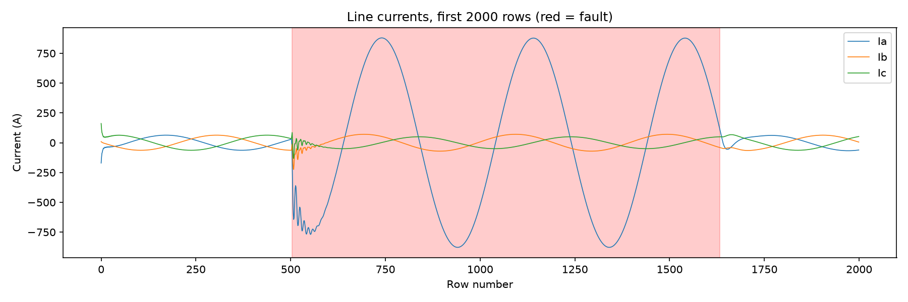
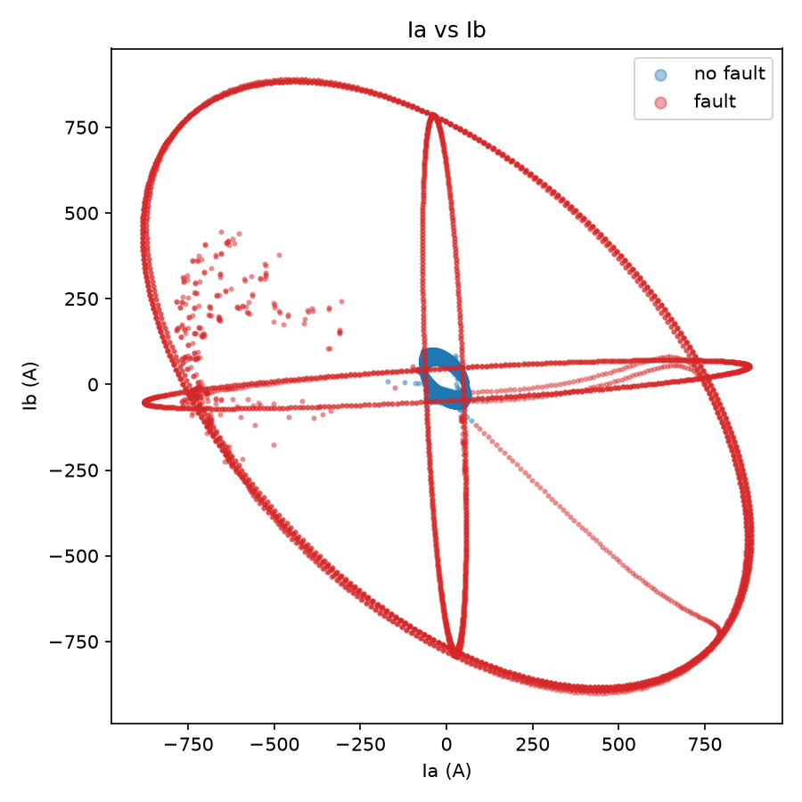
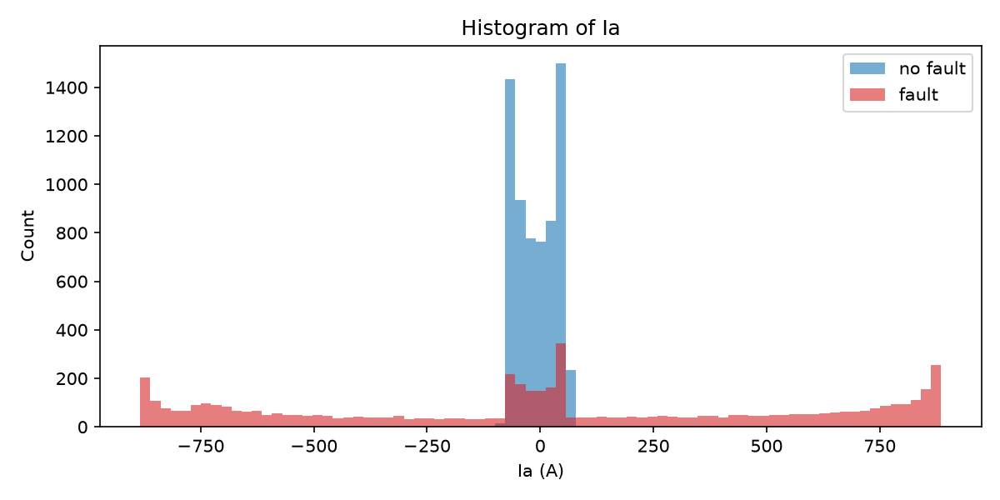

# Analysis

## Task 2: exploratory plots

For the first 504 rows all three currents are plain sine waves with peaks near 63 A. The fault runs from row 504 to row 1632, and during it Ia swings up to about 880 A while Ib and Ic stay near their normal size, apart from a short burst at the start. After the fault clears, all three currents go back to normal.

Almost all healthy rows (99.97%) have both |Ia| and |Ib| under 110 A, so they form a small cluster around the origin. Fault rows draw large loops out to about 880 A, but some of the fault traces cross the middle and run through the healthy cluster.

Healthy Ia stays between -170 A and 104 A, while fault Ia covers the whole range from -884 A to 886 A. 57.5% of the fault rows have |Ia| above 400 A, which no healthy row comes close to, but 23.7% of the fault rows have |Ia| below 100 A and sit on top of the healthy peak.

**Could one straight line in the (Ia, Ib) plane separate the two classes?** No. A fault makes the current much larger, but the current is still a sine wave, so a faulted phase passes through zero twice per cycle. At those instants Ia is close to zero and the point lands in the same small region as normal operation. The healthy rows sit in the middle of the plane and the fault rows lie on every side of them and also run through them. A straight line cuts the plane into two half-planes and cannot keep a central cluster on one side while fault points surround it. What tells a fault apart is the size of the current, not its signed value at one instant.

## Task 6: analysis

**6.1 Why do logistic regression (Set R) and the linear SVM score almost the same?**
Both models draw one straight boundary through the same six standardised features. Only the loss is different (log loss for logistic regression, hinge loss for the SVM). When no straight line fits the data well, both end up with a similarly poor line. Validation accuracy is 0.7308 and 0.7258, test accuracy is 0.7264 and 0.7359, and both miss several hundred faults (657 and 634). So the limit comes from the straight boundary and not from the training method. It tells us the two classes are not linearly separable in the raw features: healthy rows sit in the middle of the plane and fault rows lie around them, as plot 2 showed. Both models still beat the 54.4% you get by always answering "no fault", because a line can cut off the fault rows that lie on one side.

**6.2 Signs of the Set Q weights.**
The weights on the I² terms (Table 5) are positive (Ia² 18.89, Ib² 4.75, Ic² 13.96). The weights on the V² terms are negative (Va² -6.03, Vb² -6.46, Vc² -6.14). During a fault the current rises sharply: the mean of Ia² is about 2,057 for healthy rows and 308,250 for fault rows, roughly 150 times more. A large I² points to a fault, so its weight is positive. The voltage does the opposite. It sags during a fault, and the mean of Va² drops from 0.187 to 0.040. A small V² points to a fault, so its weight is negative. The three V² weights are almost equal, which fits a sag that shows on all phases. The three I² weights differ more, but the squared currents are correlated with each other, so we should not read too much into the split between them.

**6.3 Support vectors, linear against RBF.**
The best linear SVM has 5849 support vectors, which is 81% of the 7200 training rows. The best RBF SVM has 266, which is 3.7%. A very large number of support vectors means most points lie inside the margin or on the wrong side of it. The model cannot find a boundary with a clear gap between the classes, so nearly every point takes part in defining it. This is another sign that the data is not linearly separable. With few support vectors, a handful of points define a clean boundary.

**6.4 What happens as C increases?**
For the RBF SVM, accuracy goes up and the number of support vectors goes down. With γ = 1, accuracy goes 0.9804, 0.9917, 0.9962, 0.9967 and support vectors go 848, 482, 342, 266. With γ = 0.1, accuracy goes 0.9500, 0.9750, 0.9921, 0.9954 and support vectors go 1347, 723, 381, 174. C sets the penalty for points that break the margin. A small C tolerates many violations, so the margin is wide and soft, many points end up inside it (many support vectors) and the boundary is smooth but less accurate. A large C punishes violations hard, so the boundary bends to fit more training points and fewer points stay inside the margin. The gain gets small at high C (0.9962 to 0.9967), and a very large C can overfit, which is why the validation set decides where to stop. For the linear SVM nothing changes with C (0.7258 and about 5840 support vectors everywhere), because no value of C can remove the violations that a straight line cannot avoid.

**6.5 Is the test accuracy optimistic or pessimistic?**
Optimistic. The file holds only 5 blocks of consecutive fault rows (1004 to 1134 rows each), and the split is random by row. As a result 84.5% of the test rows have a direct neighbour (the row just before or after) in the training set, and neighbouring samples are almost identical. A model can score well just by recognising a sample it has practically seen, which is not the same as detecting a new fault. A real relay meets faults it was never trained on, at a different place, with a different fault resistance and a different moment of inception. A fairer test would split by event, for example train on 3 fault blocks and test on the other 2. On new events the accuracy is probably lower than 0.9958.

**6.6 Which model would we deploy?**
The RBF SVM. It misses 6 of the 1096 test faults (0.55%) and gives 4 false alarms in 1305 healthy rows (0.31%). Logistic regression on Set Q misses 45 faults (4.1%) with 6 false alarms. The two linear models on raw features never raise a false alarm, but they miss 657 and 634 faults (60% and 58%), which is not acceptable because a missed fault is worse than an unneeded trip. All 6 faults missed by the RBF SVM have every current below 64 A, so at that instant they look like normal operation. A real relay would not act on a single sample. It could trip only when several consecutive samples are predicted as fault, which would catch isolated misses like these at the price of a very small delay. Before deployment the model should also be tested with a split by event (see 6.5), because the numbers above are optimistic.

## Main question

A straight-line boundary on raw instantaneous values does not work: both linear models reach only about 73% and miss more than half of the faults. Both fixes work. Changing the features is the simplest one, since adding the six squares to the same logistic regression lifts test accuracy to 97.9%. Changing the classifier gives the best result, because the RBF SVM reaches 99.6% on the raw features with only 6 missed faults.